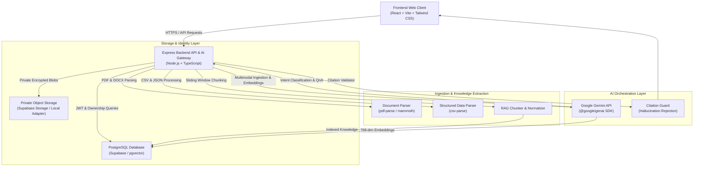
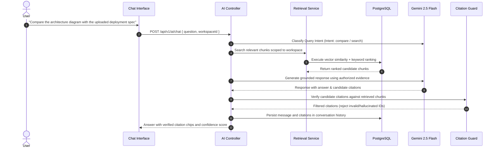

# OmniMind AI — Architecture & Systems Specification

## 1. System Overview

**OmniMind AI** is an enterprise-grade multimodal intelligence platform that enables unified cross-modal search, grounding, comparison, and synthesis across documents, images, audio, video, and structured text.

---

## 2. Core Architectural Principles

1. **Source Content vs Knowledge Representation:** Original files are preserved in private object storage, while extracted text, transcripts, and metadata are parsed into normalized chunks with token overlap.
2. **Hybrid Retrieval:** PostgreSQL pgvector cosine similarity search is combined with keyword and metadata filtering to provide low-latency, high-precision evidence candidates.
3. **Evidence Grounding & Citation Integrity:** Every factual statement produced by the generative model must cite a verified `evidence_id` from the retrieved candidate set. Fabricated citation IDs are stripped before returning responses to the user.
4. **Zero-Trust Multimodal Content:** All document contents, OCR text, and audio transcripts are treated as untrusted data and cannot override system instructions or trigger privileged actions.
5. **Multi-Tenant User Isolation:** Every database query, vector search, and file download token is strictly filtered by the authenticated user's ID (`user_id`) and workspace ID (`workspace_id`).

---

## 3. Ingestion Pipeline Data Flow

```mermaid
sequenceDiagram
    autonumber
    actor User
    participant Frontend as React Web App
    participant API as Express API
    participant Storage as Private Object Storage
    participant Worker as Ingestion Pipeline
    participant Gemini as Google Gemini AI
    participant DB as PostgreSQL (pgvector)

    User->>Frontend: Select and drop files (PDF, image, audio, video)
    Frontend->>API: POST /api/v1/documents/upload (Multipart)
    API->>API: Verify JWT & Workspace Ownership
    API->>Storage: Store original file under secure path
    API->>DB: Insert document record (status: 'queued')
    API-->>Frontend: 201 Created (Document Queued)
    
    rect rgb(15, 23, 42)
    Note over Worker,DB: Background Asynchronous Ingestion
    Worker->>Storage: Fetch file buffer
    Worker->>Worker: Parse text, metadata & duration
    Worker->>Gemini: Generate 768-dim embedding vectors & AI Summary
    Worker->>DB: Persist chunks with embeddings
    Worker->>DB: Update document status to 'ready'
    end

    Frontend->>API: GET /api/v1/documents/:id/status (Polls status)
    API-->>Frontend: { status: 'ready', summary: '...' }
```

---

## 4. Grounded Cross-Modal Question Answering Flow

